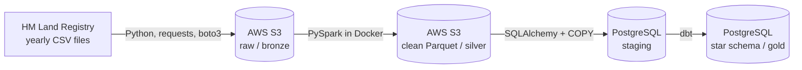

# UK Property Pipeline


An end-to-end ELT data pipeline that ingests, cleans, loads and models
**HM Land Registry Price Paid Data**: every residential property sale in
England and Wales. The pipeline processes **10 years of data (2016 to 2025),
over 10 million sales**, into a tested star schema ready for analysis.

## Architecture



All four steps are orchestrated by an **Apache Airflow** DAG, scheduled
monthly to match the Land Registry's release cycle.

| Step | Tool | What it does |
|---|---|---|
| Extract | Python, requests, boto3 | Streams yearly CSVs straight into S3 without touching local disk. Skips files already present (idempotent). |
| Transform | PySpark (Docker) | Applies an explicit schema, casts types, standardises postcodes, derives fields, removes invalid and duplicate rows, writes Parquet partitioned by year. |
| Load | SQLAlchemy, PostgreSQL COPY | Bulk loads each year as a tracked batch in a single transaction. Reruns replace data rather than duplicate it. |
| Model | dbt | Builds a star schema with data quality tests. |
| Orchestrate | Apache Airflow | Runs the steps in order with retries, logging and a monthly schedule. |

## Data model

A star schema built with dbt:

- **fact_sale**: one row per sale (price, keys to each dimension, load batch)
- **dim_date**: one row per calendar day, generated with no gaps
- **dim_location**: postcode district, town, district and county
- **dim_property**: property type, new-build flag and tenure

## Data quality

- **Spark cleaning rules**: positive prices only, valid dates only, de-duplication on transaction ID
- **13 dbt tests**: unique and not-null keys, accepted values, and referential integrity between fact and dimensions
- **Load auditing**: every load is recorded in `staging.load_batches` with status, row count and timestamps; every row carries its `batch_id`
- **Reconciliation**: row counts checked between the Spark output and the warehouse
- **9 unit tests** (pytest), run automatically on every push with GitHub Actions

## Tech stack

Python, PySpark, AWS S3, boto3, PostgreSQL, SQLAlchemy, dbt,
Apache Airflow, Docker, Docker Compose, pytest, GitHub Actions

## Project structure

```
|-- .github/workflows/ci.yml       CI: runs the test suite on every push
|-- dags/                          Airflow DAG
|-- dbt/                           dbt project (staging and mart models, tests)
|-- docker/                        Dockerfiles for Spark and Airflow
|-- src/
|   |-- ingestion/                 Extract: Land Registry to S3
|   |-- transform/                 Transform: PySpark cleaning job
|   `-- load/                      Load: S3 Parquet to PostgreSQL
|-- tests/                         pytest unit tests
`-- docker-compose.yml             Spark, PostgreSQL and Airflow services
```

## Running it locally

**Prerequisites:** Docker Desktop, Python 3.11+, an AWS account with an S3 bucket.

1. Copy `.env.example` to `.env` and fill in your values
2. Start the services: `docker compose up -d postgres airflow`
3. Open Airflow at http://localhost:8080 and trigger `uk_property_pipeline`

Run the tests with:

```
pip install -r requirements-dev.txt
python -m pytest -v
```

## Design decisions

- **ELT over ETL**: data is loaded into the warehouse before modelling, so business logic lives in version-controlled, tested SQL
- **Medallion layers**: raw (bronze) and clean (silver) in S3, star schema (gold) in PostgreSQL
- **Idempotent at every step**: any step can be rerun safely without creating duplicates
- **Least-privilege AWS access**: the pipeline uses a dedicated IAM user restricted to one bucket; credentials are kept out of version control
- **Isolated dependencies**: pipeline libraries run in a separate virtual environment inside the Airflow image to avoid dbt and Airflow version conflicts

## Future improvements

- Incremental monthly loads using the Land Registry change file (additions, changes and deletions)
- Dashboard on top of the star schema
- Infrastructure as code (Terraform) for the AWS resources

## Data source and licence

Contains HM Land Registry data © Crown copyright and database right 2021.
This data is licensed under the Open Government Licence v3.0.